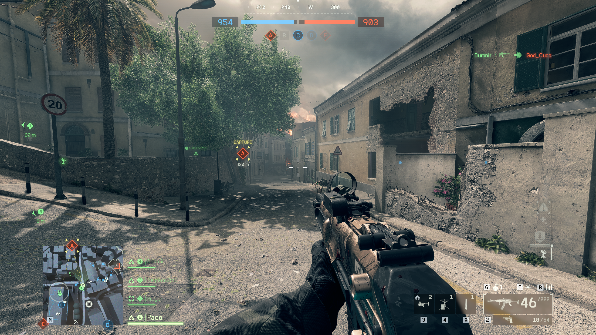
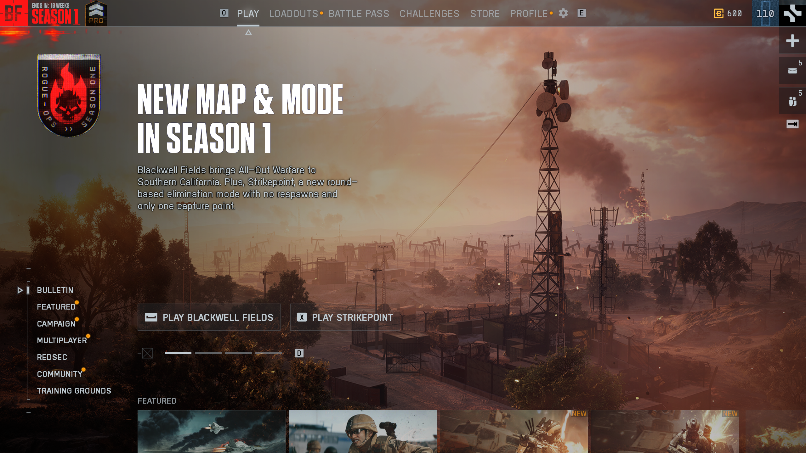
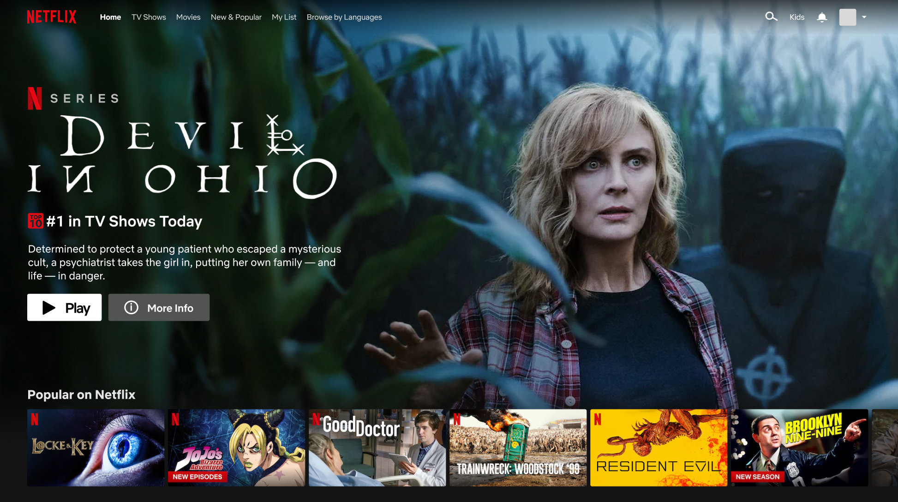

# This presentation...

<v-click>

## [...is about in-game UIs - not menus]{class="text-sky-400"}
as menus are quite boring actually

</v-click>

<v-click at="6">

## [...isn't about gamification]{class="text-sky-400"}
but it will be mentioned here and there

</v-click>

<v-click at="7">

## [...isn't apples to apples]{class="text-sky-400"}
those are two entirely different mediums after all

</v-click>

<v-switch>
<template #1>
    

        
    

  </template>
  <template #2>
    

        
    

  </template>
  <template #3>
    

        
    

  </template>
</v-switch>
